# Single-Trial EEG Classification in the Oddball Task

## Abstract

This project investigated single-trial classification of frequent standard and rare target stimuli using the Nencki–Symfonia Oddball EEG recordings from 42 participants. Preprocessing combined common-average referencing, 0.5–30 Hz filtering, participant-specific ICA assessment, 16-channel selection, resampling to 128 Hz, prestimulus baseline correction and amplitude-based epoch rejection. The selected processing version retained 24,226 trials. Participants were separated into 34 training and eight test participants. Classical ML used 320 features formed from 50 ms channel-wise averages; two DL networks used the 16 × 129 EEG arrays directly. EEG-Inception achieved the highest observed test macro-F1 of 0.8440 and balanced accuracy of 0.8632, compared with macro-F1 of 0.7578 for the initial RBF SVM. Temporal occlusion showed sensitivity to both middle and late poststimulus intervals. These findings apply to the tested configurations and fixed participant split. Differences in fitting protocols, heuristic artifact decisions and the lack of repeated-split evaluation limit broader conclusions.

## Introduction and Objectives

An Oddball task presents frequent standard stimuli among rarer stimuli, including targets that require a response. EEG records the electrical activity measured at scalp electrodes over time. Averaging stimulus-aligned EEG trials can reveal event-related potentials (ERPs), including the broad target-related positivity illustrated in the dataset publication. Single-trial classification asks whether one stimulus-aligned EEG segment contains enough information to identify the presented stimulus without averaging several trials together. [1]

The project compared explicit temporal averaging features with features learned by compact neural networks. It also examined which poststimulus intervals influenced the networks' predictions. All model inputs were derived from the selected Oddball standard and target trials. Distractors were excluded from the binary label mapping.

The three research questions were taken from the assignment.

1. What is the best single-trial classification result for frequent versus target stimuli?
2. Is deep learning better for single-trial classification than standard machine learning in the tested setting?
3. Are the features discovered by the deep learning model explainable?

The workflow comprised dataset acquisition, signal preprocessing, participant-level splitting, ML feature extraction, ML/DL fitting, held-out evaluation and descriptive visualization.
## Dataset and Data Acquisition

### Dataset and recording selection

The Nencki–Symfonia EEG/ERP dataset (OpenNeuro accession `ds004621`) contains recordings from 42 healthy adults across three experimental tasks (Oddball, MSIT+, and SRT) and a resting-state protocol. The study used a 128-electrode cap. The Oddball recordings were sampled at 1,000 Hz, and the downloaded channel tables list **127 EEG channels per participant**. Preprocessing used the available recorded EEG channels for ICA, followed by selection of 16 channels for model input. [1–3]

We selected the Oddball recordings because the research question asks whether a single EEG segment can distinguish a frequent standard stimulus from a rare target stimulus. The Oddball protocol also presented rare distractors. Participants were instructed to press a button when a target appeared. The task metadata gives approximate stimulus proportions of 76% standard, 12% target, and 12% distractor. The download excluded MSIT+, SRT, resting-state recordings, participant metadata tables, and auxiliary study files because the binary classification uses the Oddball EEG and stimulus markers. [1–3]

### Files and provenance

We retrieved 213 files for 42 participants (27.19 GiB) from the public OpenNeuro mirror. The download contains five files per participant and three shared metadata files. The acquisition manifest records each file's source, size, checksum, and the per-participant event and channel counts. [2,4]

| File | Role in the analysis |
|---|---|
| `*_eeg.eeg` | Continuous EEG samples in BrainVision binary format. |
| `*_eeg.vhdr` | BrainVision header used to open the recording in MNE. It specifies the signal format and references the signal and marker files. |
| `*_eeg.vmrk` | BrainVision event markers at sample positions. |
| `*_events.tsv` | Event table. The `onset` field gives event time in seconds and `event_type` identifies the event. |
| `*_channels.tsv` | Channel inventory used to identify EEG channels and verify the recorded channel count. |
| `task-oddball_eeg.json` | Shared description of the Oddball protocol and acquisition settings. |
| `task-oddball_events.json` | Shared dictionary for the event table and its codes. |
| `dataset_description.json` | Dataset identification and provenance. |

### Event codes and candidate trials

One standard or target onset defines one candidate trial. We use the stimulus onset in `events.tsv` as time zero for epoching and use the stimulus code to assign the class. Button presses are recorded separately. A target retains its target label even if the participant did not press the button. The downloaded continuous EEG and event tables preserve all event types. [3,4]

| Event code | Meaning | Raw event rows | Use |
|---|---|---:|---|
| `S 5` | Standard or frequent stimulus | 21,018 | Class 0 |
| `S 6` | Target stimulus | 3,422 | Class 1 |
| `S 7` | Distractor or deviant stimulus | 3,425 | Excluded from the binary sample set |
| `S 1` | Recorded button response | 3,872 | Retained as event metadata |
| `S 10` | Break marker | 168 | Retained as event metadata |
| `S 12` | Beginning-of-run marker | 125 | Retained as event metadata |

The inventory also lists one entry each for `R 15`, `S 14`, and `S 15`, plus two entries reported as `empty`. The binary label mapping uses only `S 5` and `S 6`. The downloaded event tables contain **24,440 candidate binary trials**, of which **86.0% are standard**. These counts precede epoch validation and artifact rejection. Post-preprocessing counts are reported in the following section. [4]

## Preprocessing

### Input data and event alignment

Preprocessing covered all 42 Oddball recordings, with 127 recorded EEG channels per participant and an original sampling frequency of 1,000 Hz. Standard (S 5) and target (S 6) events defined 24,440 candidate binary trials. Distractor and response markers remained in the original recordings. Stimulus onsets from the event tables were checked against the BrainVision annotations before epoching.

### Processing steps and rationale

1. Channel checks identified previously marked bad channels, non-finite values, and channels that were constant across the recording. Usable EEG channels were re-referenced to their common average.
2. Continuous EEG was filtered with a fourth-order Butterworth band-pass filter at 0.5–30 Hz, applied forward and backward. This reduced slow drift and high-frequency activity outside the selected analysis band.
3. ICA was fitted independently for each participant using up to 30 components and a fixed random seed of 42. Fitting used a 250 Hz copy with an additional 1 Hz high-pass filter. The saved decomposition was applied to the continuous 0.5–30 Hz data. A 1 Hz high-pass copy for fitting is supported by the MNE ICA guidance. [5]
4. For sub-01, component 0 was selected after reviewing its time course alongside Fp1 and Fp2. For the other participants, automatic selection required a component to be an MNE candidate for both frontal channels and to have an absolute correlation of at least 0.9 with each. This frontal-proxy rule is a project heuristic because the imported recordings had no channels identified as EOG. The 0.9 threshold was fixed for this automatic selection rule. Applying the rule removed components in 28 further participants. For 13 participants, no component met the rule. We retained their filtered EEG without component removal as the decision for this processing version, avoiding removal on weaker frontal-proxy evidence. The quality logs retain the automated review status for these participants.
5. Following reconstruction, the selected channels were F3, Fz, F4, T7, C3, Cz, C4, T8, CP3, CP4, P3, Pz, P4, PO7, PO8 and Oz. ICA and the common-average reference used the available full recording before this selection. This 16-electrode configuration has precedent in P300 classification research. [6]
6. Signals and event sample positions were jointly resampled to 128 Hz. Epochs covered approximately -200 to 1,000 ms on the resampled time grid. The prestimulus interval up to 0 ms provided the baseline. Baseline-corrected samples from 0 to 1,000 ms were retained for the model, giving 129 time points including both endpoints.
7. An epoch was rejected when any selected EEG channel had peak-to-peak amplitude above 150 µV or below 0.1 µV across the full epoch. Peak-to-peak amplitude is the maximum minus the minimum within a channel and epoch. MNE implements both maximum-amplitude and minimum-amplitude rejection this way. [7]

A published ERP study used a 150 µV peak-to-peak criterion in overlapping 200 ms windows stepped by 100 ms. Our whole-epoch criterion is an adaptation with a different observation window. The 0.1 µV cutoff was chosen as a near-flat safeguard. Its numerical value has not been validated here as optimal for this dataset. Both values should be interpreted alongside rejection counts and signal inspection. [7,8]

### Reasons for the selected processing strategy

The initial loss of 392 out of 579 candidate sub-01 trials prompted inspection of channel amplitudes and ICA components. Widespread frontal transients motivated ocular-artifact correction before amplitude rejection. The sub-01 correction recovered trials while keeping the rejection thresholds fixed.

The literature-based 16-channel configuration reduces input size while retaining spatial coverage relevant to the Oddball ERP analysis. Selecting channels after ICA preserves the use of frontal channels as ocular-artifact proxies during cleaning. Sub-01 retained the same number of trials with 16 channels as with 127 after ICA correction. Classification results for the selected channels are reported in the ML and DL sections.

All 42 participants were retained under the selected quality criteria. Behavioral errors reported for sub-02, sub-14 and sub-17 were considered separately from stimulus-based labels. For the 13 participants without components meeting the automatic threshold, retaining the filtered EEG avoids forcing uncertain component removals. Residual artifacts are an acknowledged limitation of this version.

### Investigation of excessive trial rejection

The first sub-01 run tested the amplitude thresholds across 127 channels before removing ICA components. It retained 175/498 standards and 12/81 targets. Fp2 exceeded 150 µV in 391 of 579 candidate epochs, while the diagnostic table showed no channel below the 0.1 µV threshold. Fp1 and other frontal channels were also frequently flagged.

The component-0 trace showed repeated transients synchronized with large bilateral Fp1/Fp2 peaks. After its reviewed exclusion, 496/498 standards and 81/81 targets were retained at the same thresholds. Selecting 16 channels after this ICA correction retained the same 577 epochs. The pilot therefore motivated artifact correction before rejection.

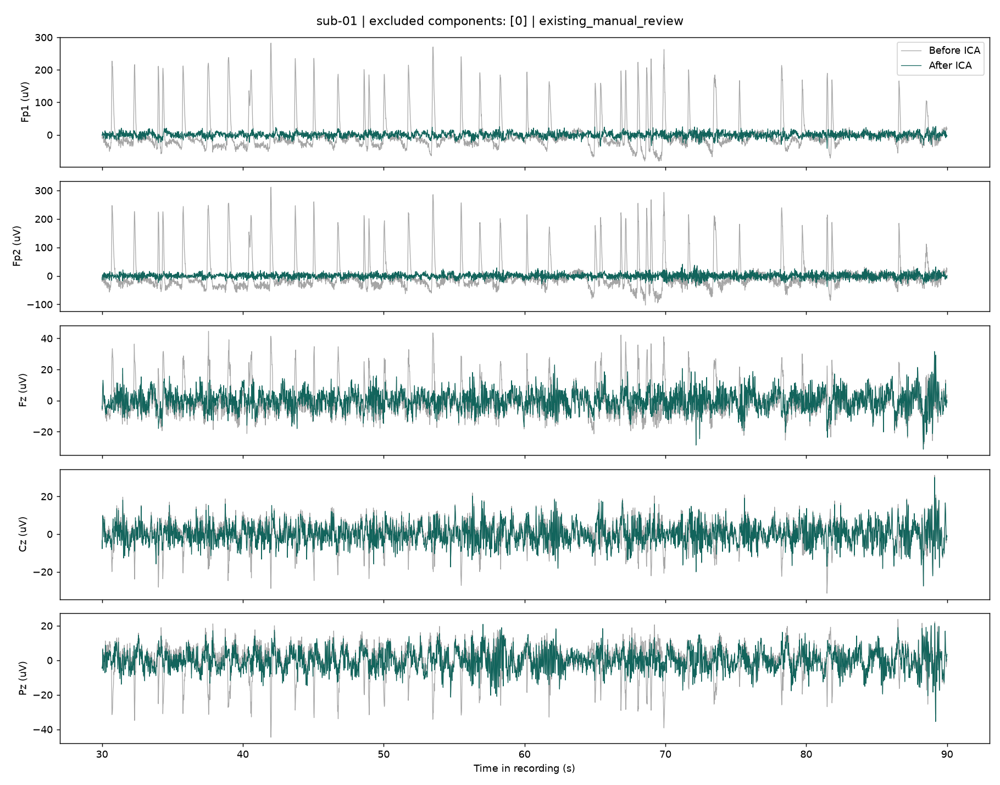

Figure 1. Sub-01 EEG before and after the reviewed removal of component 0. The separate pilot component time-course inspection motivated this decision. The overlay records its effect on frontal and midline channels.

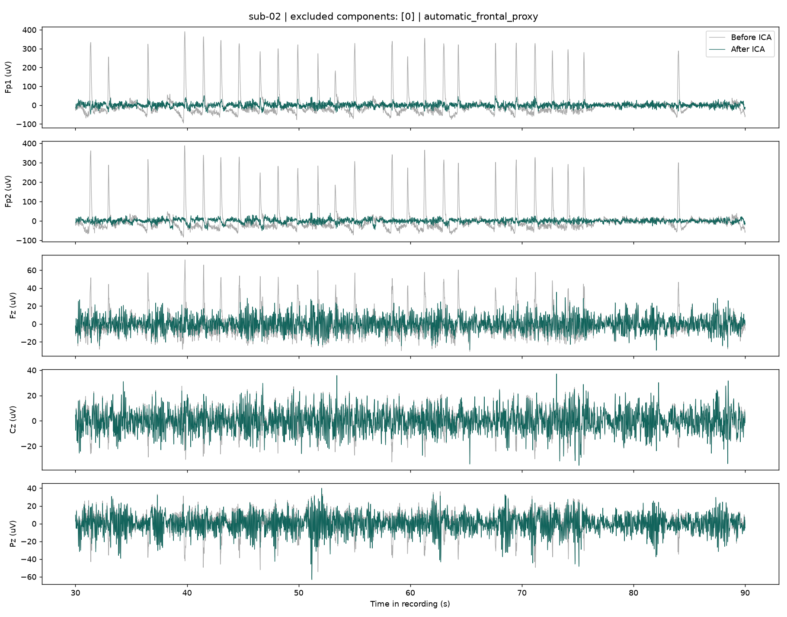

Figure 2. Sub-02 EEG before and after removal of component 0. Large frontal transients decreased. Over the displayed 30–90 second interval, Fp1 peak-to-peak amplitude decreased from approximately 486.5 to 98.8 µV and Fp2 from 472.1 to 92.0 µV. Cz and Pz had similar interval peak-to-peak amplitudes before and after processing. The overlay illustrates a local signal-quality check; model performance will be evaluated separately.

### Cohort outputs and remaining quality issues

The final epoch-generation run completed for all 42 participants with no recorded errors. Each saved array contains 16 channels and 129 time points per retained trial. Signal values are stored in volts, with channel names, relative sample times, participant identity, original stimulus sample positions, and labels (0 standard, 1 target).

| Class | Candidate trials | Retained trials | Rejected trials |
|---|---:|---:|---:|
| Standard | 21,018 | 20,827 | 191 |
| Target | 3,422 | 3,399 | 23 |
| Total | 24,440 | 24,226 | 214 |

Overall, 99.12% of candidate trials were retained. This represents the current processing version. ICA component removal was applied in 29 participants, including the manually reviewed sub-01. The other 13 were retained without component removal because no component met the automatic criterion. These participants are sub-03, sub-08, sub-12, sub-14, sub-18, sub-23, sub-25, sub-26, sub-30, sub-34, sub-35, sub-40 and sub-41. High retention alone does not establish artifact-free EEG.

| Participant | Retained standard | Retained target | ICA action |
|---|---:|---:|---|
| sub-01 | 496/498 | 81/81 | Reviewed removal of component 0 |
| sub-02 | 495/498 | 80/81 | Automatic removal of component 0 |
| sub-07 | 432/498 | 75/81 | Automatic removal of component 0 |
| sub-14 | 479/498 | 78/81 | No component met the automatic rule |
| sub-17 | 488/498 | 79/81 | Automatic removal of component 0 |

Sub-07 had the largest loss of trials and remains a priority for signal inspection. Sub-02, sub-14 and sub-17 were retained in the current dataset. Their known behavioral issues and the signal-quality checks address different aspects of the experiment. Counts for sub-23 and sub-38 begin above those of most participants; the present inventory alone does not explain the extra events.

The numerical results in this section were checked against the server-generated after_ica summary and participant split inventory. These counts define the preprocessing version selected for the current experiments. Possible residual ocular artifacts in the 13 participants without component removal remain a limitation.

## Participant-level Train/Test Preparation

A fixed shuffle with seed 42 assigned 34 participants to training and 8 to testing. The sets contain no shared participants and together cover all 42 participants. Channel order, time grid and per-participant class counts were validated by the split-generation script and checked against the preprocessing summary.

| Set | Participants | Standard trials | Target trials | Total trials |
|---|---:|---:|---:|---:|
| Train | 34 | 16,931 | 2,761 | 19,692 |
| Test | 8 | 3,896 | 638 | 4,534 |

The test participants are sub-02, sub-07, sub-08, sub-09, sub-15, sub-16, sub-18 and sub-41. The base split inventory has an empty validation list. DL training derived a four-participant validation subset inside these 34 training participants, as detailed below. Test results were used for the final evaluation and descriptive occlusion analysis. The processing quality statuses remain attached to the participant reports.

## Classical Machine Learning

### Feature extraction and initial models

For each of 16 channels, the baseline-corrected 0–1000 ms signal was averaged over 20 consecutive 50 ms windows, producing 320 features per trial in channel-major order. The final window included the sample at 1000 ms. Timestamps defined window membership because 50 ms does not correspond to an integer number of samples at 128 Hz. Amplitudes were converted to microvolts.

We evaluated a majority-class baseline, LDA with automatic covariance shrinkage and equal class priors, and an RBF SVM with C=1, gamma=scale and balanced class weights. Standardization for LDA and SVM was fitted on training participants only. Initial parameters were fixed before test evaluation. All models used 19,692 training trials from 34 participants and 4,534 test trials from the same eight held-out participants.

### Initial held-out ML results

| Model | Macro-F1 | Standard correctly classified | Standard predicted target | Target predicted standard | Target correctly classified |
|---|---:|---:|---:|---:|---:|
| Majority baseline | 0.4622 | 3,896 | 0 | 638 | 0 |
| Shrinkage LDA | 0.7103 | 3,258 | 638 | 176 | 462 |
| RBF SVM | 0.7578 | 3,690 | 206 | 294 | 344 |

Confusion matrices use true labels as rows and predicted labels as columns, with standard followed by target. SVM achieved the highest macro-F1 of the initial models. LDA detected 462 of 638 targets (72.4%), while SVM detected 344 (53.9%). SVM generated fewer false target predictions, 206 compared with 638 for LDA. These results show different error tradeoffs. The majority baseline missed every target, illustrating the importance of class-sensitive evaluation.

The comparison concerns these initial configurations and this participant split. Subsequent hyperparameter selection should use participant-level validation inside the training set. The elapsed times recorded in the supplied JSON files include fitting and prediction and depend on the execution environment.

## Deep Learning

### Input representation and architectures

Both networks received the baseline-corrected EEG directly as a 16-channel by 129-time-point array covering 0–1000 ms at 128 Hz. The networks learned temporal and spatial features from the signal. The DL input retained the temporal samples used to form the 50 ms averages for classical ML.

The project Compact EEG CNN contained 1,162 trainable parameters. An initial temporal convolution used eight filters of length 33 samples. A grouped convolution across the 16 channels produced 16 spatial features. Batch normalization, ELU activation, average pooling and dropout were followed by a depthwise temporal convolution of length 17, pointwise mixing, a second pooling block, global average pooling and a two-class linear classifier. Dropout probability was 0.5. This is the compact architecture implemented in the project.

The second network used Braindecode's EEGInceptionERP with 16 input channels, two outputs, 129 time points and a 128 Hz sampling frequency. Its multi-scale temporal branches provide filters at different durations with spatial processing. The instantiated network contained 15,310 trainable parameters. Its ERP-oriented design provided a second compact approach to single-trial classification. [9]

### Fitting, validation and checkpoint selection

Within the original 34 training participants, a fixed seed of 42 selected sub-10, sub-20, sub-27 and sub-28 for validation. The remaining 30 participants supplied 17,383 fitting trials; validation contained 2,309 trials. Both networks used the same assignments. The eight test participants and their 4,534 trials matched the ML evaluation set.

Per-channel mean and standard deviation were computed across trials and time using fitting participants only. These values standardized fitting, validation and test EEG. Class-weighted cross-entropy used inverse-frequency weights of approximately 0.582 for standard and 3.566 for target, calculated from the fitting labels. This increased the contribution of the less frequent target class to the fitting objective.

The optimizer was AdamW with learning rate 0.001 and weight decay 0.01. Batch size was 64. Both networks completed 100 epochs on CUDA, with early stopping disabled. After each epoch, macro-F1 was computed on validation participants. The checkpoint with the highest validation macro-F1 was selected for test evaluation. Saved checkpoints include normalization values, channel order and participant assignments.

| Network | Parameters | Completed epochs | Selected epoch | Best validation macro-F1 | Test macro-F1 |
|---|---:|---:|---:|---:|---:|
| Compact EEG CNN | 1,162 | 100 | 83 | 0.8317 | 0.7937 |
| EEG-Inception | 15,310 | 100 | 80 | 0.8648 | 0.8440 |

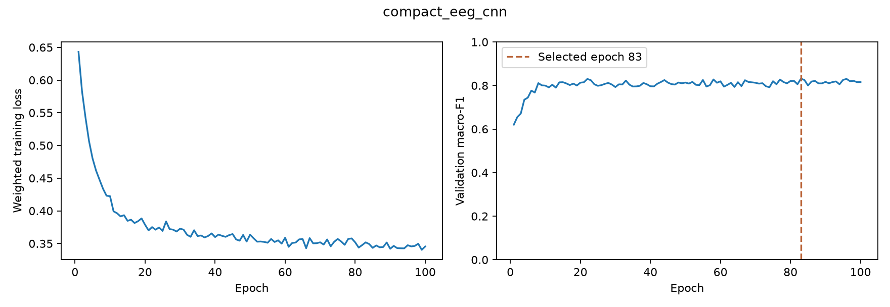

Figure 3. Compact CNN weighted training loss and validation macro-F1. The vertical line marks the selected checkpoint at epoch 83.

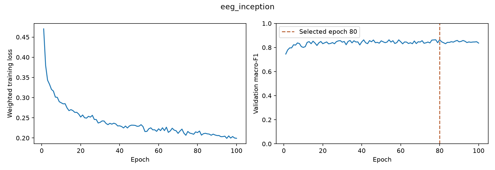

Figure 4. EEG-Inception weighted training loss and validation macro-F1. Validation performance improved rapidly early in training and subsequently fluctuated. The best checkpoint occurred at epoch 80. Final-epoch validation macro-F1 was 0.8365, below the best value of 0.8648. The curves support selecting a checkpoint using validation performance. The available logs contain training loss and validation macro-F1; they do not contain validation loss or training macro-F1 for a like-for-like generalization-gap analysis.

### Evaluation definitions

Macro-F1 was the primary evaluation metric. Precision and recall were computed separately for each class, combined into the class F1 value, and averaged equally across standard and target. Confusion matrices report the underlying prediction counts. Balanced accuracy is additionally reported as the mean of standard recall and target recall. Both metrics give equal class-level weighting, but macro-F1 also depends on precision.

For each class, F1 = 2TP / (2TP + FP + FN). For the binary task, balanced accuracy = (recall_standard + recall_target) / 2. These metrics were computed from trial-level predictions pooled across the held-out participants. The pooled scores are not averages of separate participant scores.

## Comparison of Machine Learning and Deep Learning

All five models were evaluated on the same 3,896 standard and 638 target trials from eight held-out participants. Macro-F1 gives equal weight to the two class-specific F1 values, making the complete failure of the majority baseline to detect targets visible.

| Model | Test macro-F1 | Standard correct | Standard predicted target | Target predicted standard | Target correct |
|---|---:|---:|---:|---:|---:|
| Majority baseline | 0.4622 | 3,896 | 0 | 638 | 0 |
| Shrinkage LDA | 0.7103 | 3,258 | 638 | 176 | 462 |
| RBF SVM | 0.7578 | 3,690 | 206 | 294 | 344 |
| Compact EEG CNN | 0.7937 | 3,620 | 276 | 199 | 439 |
| EEG-Inception | **0.8440** | 3,673 | 223 | 138 | 500 |

Confusion matrices use standard then target for rows and columns. Rows indicate the true class and columns the prediction.

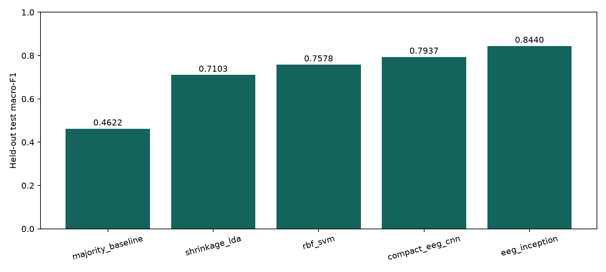

Figure 5. Macro-F1 for the five implemented configurations on the common test participants.

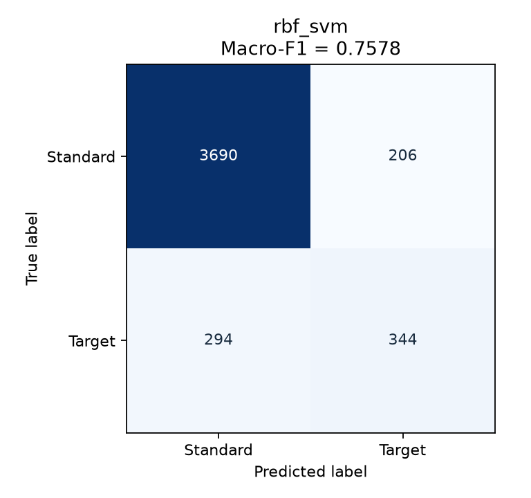

Figure 6. Confusion matrix of the strongest initial ML configuration.

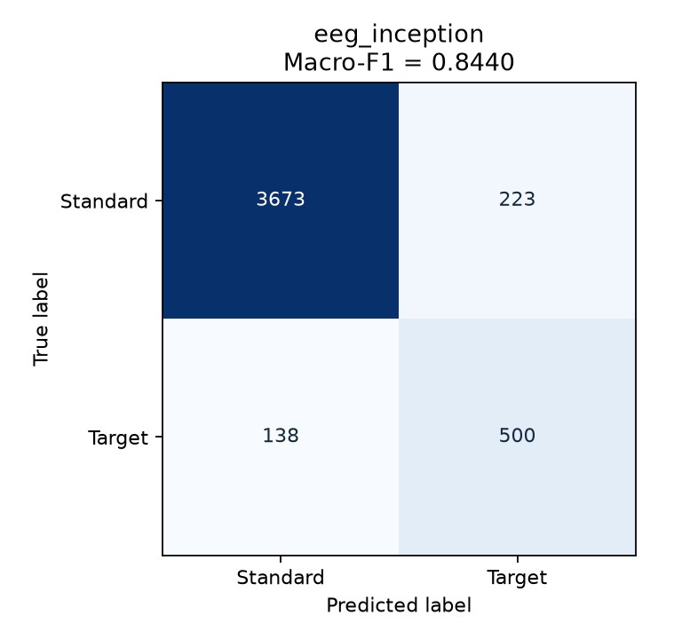

Figure 7. Confusion matrix of the highest-scoring DL configuration.

EEG-Inception exceeded SVM macro-F1 by 0.0861 and Compact CNN by 0.0503. It correctly identified 500/638 targets (78.4%), compared with 439/638 (68.8%) for Compact CNN, 462/638 (72.4%) for LDA and 344/638 (53.9%) for SVM. Relative to SVM, EEG-Inception recovered 156 additional targets with 17 additional false target predictions. Relative to LDA, it recovered 38 additional targets and generated 415 fewer false target predictions.

Balanced accuracy computed from the same confusion matrices gives the following complementary comparison.

| Model | Macro-F1 | Balanced accuracy |
|---|---:|---:|
| Majority baseline | 0.4622 | 0.5000 |
| Shrinkage LDA | 0.7103 | 0.7802 |
| RBF SVM | 0.7578 | 0.7432 |
| Compact EEG CNN | 0.7937 | 0.8086 |
| EEG-Inception | 0.8440 | 0.8632 |

EEG-Inception ranked highest on both measures. LDA exceeded SVM in balanced accuracy because it recovered more targets, while SVM achieved higher macro-F1 through its different precision–recall tradeoff.

The shared test set supports comparison of these fitted systems. Their fitting protocols differ. ML used all 34 training participants, while DL used 30 for fitting and four for validation. DL selected an epoch over 100 validation assessments; ML used fixed initial hyperparameters. These differences should be considered when interpreting the observed ranking.

## Visualization and Model Explanation

### ERP at Pz

For each of the 34 training participants, class-specific averages were computed at Pz and then averaged across participants with equal participant weighting. Shading shows one between-participant standard deviation. The model-ready epochs contain the poststimulus interval, so this plot begins at 0 ms.

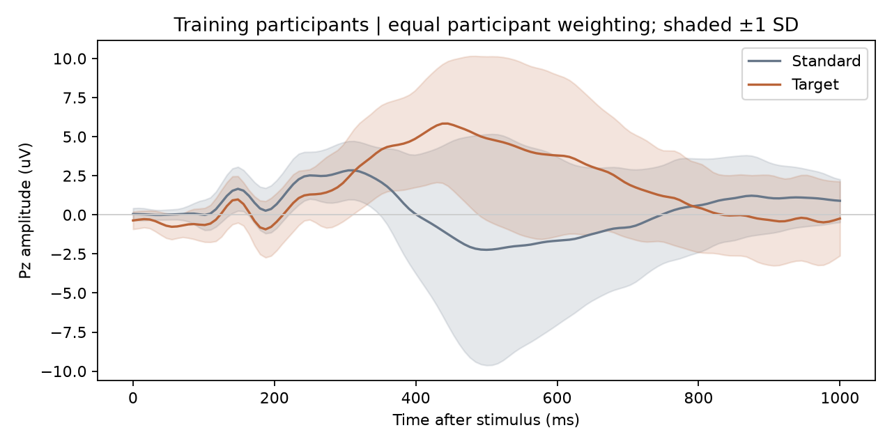

Figure 8. Pz ERP for standard and target trials after preprocessing. Shading describes participant variability.

The target waveform showed a broad positive response with a maximum within 300–600 ms at approximately 445 ms and 5.84 µV. Standard and target averages separated over much of the middle and later poststimulus interval. This timing and parietal positivity are consistent with the Oddball P3 response discussed by the dataset authors. The plot is descriptive and no statistical test of the waveform difference was performed. [1]

### Distributions of ML features

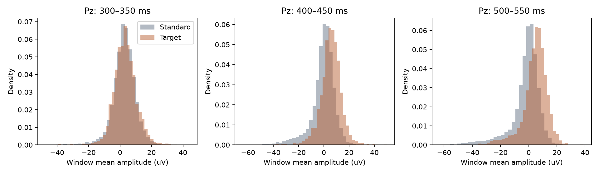

Figure 9. Training-trial distributions of Pz mean amplitudes in the prespecified 300–350, 400–450 and 500–550 ms windows. Histograms are normalized within each class so that their different sample counts do not determine the displayed height.

These distributions illustrate the representation supplied to LDA and SVM. Each value summarizes one channel over one 50 ms window. Distribution overlap shows why a single selected feature can leave ambiguous trials. Classification combines information across 16 channels and 20 windows. These plots provide examples of the features and do not measure the models' feature importance.

### Temporal occlusion of the DL checkpoints

The selected checkpoints were evaluated without further fitting. First, unmodified predictions were checked against the saved confusion matrices. Each of ten consecutive 100 ms intervals was then masked across all 16 channels, one interval at a time. Masked values were set to zero after normalization, equivalent to the channel mean estimated on fitting participants. The final interval included the 1000 ms endpoint.

For each interval, the reported effect was the unmasked test macro-F1 minus the masked macro-F1. A positive effect means masking reduced performance. This is a perturbation-sensitivity experiment using the same baseline-replacement idea described in occlusion methods. The project implementation evaluates aggregate performance changes over intervals. [10]

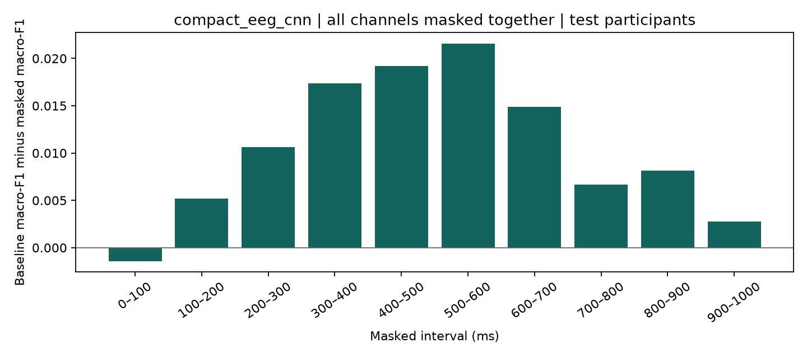

Figure 10. Compact CNN macro-F1 changes after masking each 100 ms interval.

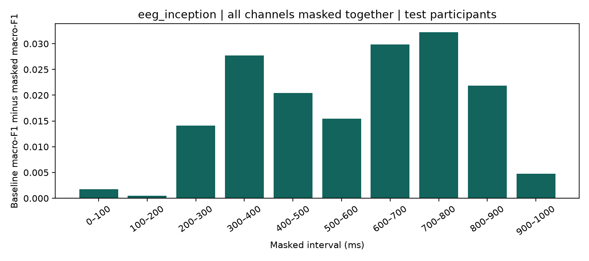

Figure 11. EEG-Inception macro-F1 changes under the same masking procedure.

| Network | Most influential masked interval | Unmasked macro-F1 | Masked macro-F1 | Decrease |
|---|---|---:|---:|---:|
| Compact EEG CNN | 500–600 ms | 0.7937 | 0.7721 | 0.0216 |
| EEG-Inception | 700–800 ms | 0.8440 | 0.8117 | 0.0323 |

Compact CNN was also sensitive to 400–500 ms (decrease 0.0192) and 300–400 ms (0.0173). EEG-Inception was sensitive to 600–700 ms (0.0299), 300–400 ms (0.0278), 800–900 ms (0.0219), and 400–500 ms (0.0204). The first 200 ms produced relatively small changes for both networks. Masking 0–100 ms slightly improved Compact CNN macro-F1 by 0.0014; performance changes need not be positive.

Both networks show sensitivity within the ERP interval, while EEG-Inception also uses information in later intervals. The strongest EEG-Inception change at 700–800 ms means that its decision cannot be attributed entirely to the P300 peak. Late information could reflect extended processing or responses associated with the task; these alternatives were not separated experimentally. These results describe sensitivity to the chosen mask and do not identify causal neural sources.

## Discussion of the Research Questions

### RQ1. What is the best single-trial classification result for frequent versus target stimuli?

The highest test macro-F1 among the implemented configurations was **0.8440**, obtained by EEG-Inception using 16 channels and a one-second single-trial input. Its confusion matrix contained 3,673 correctly classified standards, 223 false target predictions, 138 missed targets and 500 correctly classified targets. This result applies to the fixed participant-level split and current preprocessing version. It is the best observed configuration in this project.

### RQ2. Is deep learning better than standard machine learning for single-trial classification?

Both implemented DL networks exceeded the strongest initial ML baseline in macro-F1. Compact CNN achieved 0.7937 and EEG-Inception 0.8440, compared with 0.7578 for SVM. These observations support DL for the configurations and split studied. A broader conclusion requires repeated participant splits, balanced model-selection effort and uncertainty estimates. In addition, direct time-series input and 50 ms mean features differ in retained temporal detail, so the comparison combines architecture and input-representation choices.

### RQ3. Are the features discovered by the deep learning model explainable?

Temporal occlusion provides partial explanation of the trained networks' behavior. Sensitivity in approximately 300–600 ms aligns with the broad target positivity observed at Pz. EEG-Inception also shows substantial sensitivity in 600–900 ms. This identifies intervals worth further examination and supports an explanation involving both middle and late poststimulus information. The current experiment masks all channels jointly, so it cannot assign the effect to a particular electrode or distinguish specific ERP components, motor activity and residual artifacts.

## Limitations and Scope of Conclusions

- **One participant split and one training seed.** The results have no confidence intervals or paired significance tests, and generalization beyond these eight test participants remains uncertain.
- **Different model-selection protocols.** ML used 34 fitting participants and fixed parameters. DL used 30 fitting participants, four validation participants and best-epoch selection. The present comparison covers these complete protocols.
- **ICA decisions and residual artifacts.** Thirteen participants retained filtered signals without component removal because no component met the automatic frontal-proxy rule. The 0.9 threshold and the 0.1 µV flatness safeguard are project choices. Two illustrated before/after examples do not establish artifact-free EEG for every participant.
- **Channel and amplitude choices.** The project selected 16 channels and fixed whole-epoch rejection thresholds. It did not complete a full 127-versus-16-channel classification comparison or threshold-sensitivity study. Higher trial retention alone does not establish better classification.
- **Behavior and stimulus labels.** Labels follow stimulus identity even when participants respond incorrectly. Sub-02, sub-14 and sub-17 were retained despite the behavioral concerns described by the dataset authors. This may add variability in task engagement.
- **Limited explanation method.** Occlusion depends on the reference value and window width. Abrupt masking can produce inputs that differ from natural EEG, and individual-window effects need not add together. A stronger effect in a late interval may involve several task-related processes. The analysis does not establish neural causality.
- **Use of held-out results.** Test results were inspected for reporting and descriptive explanation. Subsequent model or preprocessing changes informed by these results would require a fresh evaluation plan to support an unbiased final performance claim.
- **Reproducibility records.** Checkpoints record normalization and participant assignments; metric files record library versions and settings. Dataset file checksums and quality reports should accompany the code version used for the experiments. Local absolute paths in the split inventory must be adapted when relocating the server data.

## Conclusion

This project prepared 24,226 standard/target trials from 42 participants and compared three classical ML configurations with two compact DL networks on participant-disjoint test data. EEG-Inception achieved the highest observed macro-F1 of 0.8440. Pilot ICA correction reduced frontal transients and recovered trials, while temporal occlusion indicated that the DL models depend on both ERP-timed and later information. The reported result and explanations are specific to the current preprocessing, participant split and model-selection procedures.

## Group Member Contributions

| Member name | Responsibilities and contributions | Contribution (%) |
|---|---|---|
|  |  |  |
|  |  |  |
|  |  |  |
|  |  |  |

Total contribution (%) ____________________

## References

1. Dzianok P, Antonova I, Wojciechowski J, Dreszer J, Kublik E. The Nencki-Symfonia electroencephalography/event-related potential dataset. *GigaScience*. 2022. [doi:10.1093/gigascience/giac015](https://doi.org/10.1093/gigascience/giac015).
2. Dzianok P, Antonova I, Wojciechowski J, Dreszer J, Kublik E. Nencki–Symfonia EEG/ERP dataset. [OpenNeuro ds004621](https://openneuro.org/datasets/ds004621). [GigaDB dataset DOI](https://doi.org/10.5524/100990).
3. OpenNeuroDatasets. [Oddball acquisition metadata](https://raw.githubusercontent.com/OpenNeuroDatasets/ds004621/main/task-oddball_eeg.json) and [event dictionary](https://raw.githubusercontent.com/OpenNeuroDatasets/ds004621/main/task-oddball_events.json).
4. Project data acquisition inventory. [Oddball EEG dataset and acquisition](data_acquisition.pdf), p. 2.

5. MNE. [Repairing artifacts with ICA](https://mne.tools/stable/auto_tutorials/preprocessing/40_artifact_correction_ica.html).
6. [Electrode subset selection methods for an EEG-based P300 brain-computer interface](https://pmc.ncbi.nlm.nih.gov/articles/PMC4133302/).
7. MNE. [Epochs API and peak-to-peak rejection](https://mne.tools/stable/generated/mne.Epochs.html).
8. Navid MS, Niazi IK, Lelic D, Drewes AM, Haavik H. (2019). The Effects of Filter’s Class, Cutoff Frequencies, and Independent Component Analysis on the Amplitude of Somatosensory Evoked Potentials Recorded from Healthy Volunteers. Sensors 19(11), 2610. [doi:10.3390/s19112610](https://doi.org/10.3390/s19112610).

9. Braindecode. [EEGInceptionERP architecture and ERP reference](https://braindecode.org/stable/generated/braindecode.models.EEGInceptionERP.html).
10. Captum. [Occlusion method and baseline replacement](https://captum.ai/api/occlusion.html). The project uses its own temporal masking implementation.
