# Phân loại EEG theo từng lượt trong tác vụ Oddball

## Tóm tắt

Dự án nghiên cứu phân loại từng lượt EEG ứng với kích thích thường gặp (standard) và kích thích mục tiêu hiếm gặp (target) trên dữ liệu Oddball Nencki–Symfonia của 42 người. Tiền xử lý gồm tham chiếu trung bình, lọc 0,5–30 Hz, đánh giá ICA riêng từng người, chọn 16 kênh, lấy mẫu lại ở 128 Hz, chỉnh nền trước kích thích và loại lượt theo biên độ. Phiên bản xử lý được chọn giữ lại 24.226 lượt. Dữ liệu được chia theo người thành 34 người huấn luyện và 8 người kiểm tra. Các mô hình học máy truyền thống dùng 320 đặc trưng trung bình trên các cửa sổ 50 ms; hai mạng học sâu nhận trực tiếp mảng EEG 16 × 129. EEG-Inception đạt macro-F1 cao nhất trên tập kiểm tra là 0,8440 và balanced accuracy là 0,8632; SVM RBF cấu hình ban đầu đạt macro-F1 0,7578. Thử che tín hiệu cho thấy mô hình nhạy với cả khoảng giữa và khoảng muộn sau kích thích. Kết quả áp dụng cho các cấu hình và cách chia người đã thử. Sự khác nhau trong quy trình huấn luyện, quy tắc xử lý nhiễu dựa trên kinh nghiệm và việc chưa đánh giá qua nhiều lần chia dữ liệu giới hạn phạm vi kết luận.

## Giới thiệu và mục tiêu

Tác vụ Oddball trình bày các kích thích standard thường gặp xen với các kích thích hiếm, trong đó target yêu cầu người tham gia phản ứng. EEG ghi hoạt động điện đo tại các điện cực trên da đầu theo thời gian. Lấy trung bình nhiều lượt EEG được căn theo thời điểm kích thích có thể làm rõ điện thế liên quan sự kiện (ERP), gồm đáp ứng dương rộng liên quan đến target được mô tả trong công bố bộ dữ liệu. Phân loại từng lượt đặt câu hỏi liệu một đoạn EEG căn theo một kích thích có đủ thông tin nhận diện kích thích vừa xuất hiện hay không. [1]

Dự án so sánh đặc trưng trung bình theo thời gian với đặc trưng do mạng nơ-ron nhỏ gọn học từ tín hiệu. Đồng thời, dự án khảo sát khoảng thời gian sau kích thích nào ảnh hưởng đến dự đoán. Đầu vào mô hình được tạo từ các lượt standard và target của Oddball; distractor được bỏ qua khi tạo nhãn hai lớp.

Ba câu hỏi nghiên cứu lấy từ đề bài gồm các nội dung sau.

1. Kết quả phân loại từng lượt tốt nhất giữa kích thích thường gặp và target là bao nhiêu?
2. Trong thiết lập được thử, học sâu có tốt hơn học máy truyền thống khi phân loại từng lượt không?
3. Có thể giải thích các đặc trưng mà mô hình học sâu phát hiện không?

Quy trình gồm thu thập dữ liệu, tiền xử lý tín hiệu, chia theo người, trích đặc trưng ML, huấn luyện ML/DL, đánh giá trên tập kiểm tra và trực quan hóa. Các mục tiếp theo trình bày lý do xử lý và kết quả quan sát được.

## Bộ dữ liệu và thu thập dữ liệu

### Bộ dữ liệu và lựa chọn bản ghi

Nencki–Symfonia EEG/ERP, mã OpenNeuro `ds004621`, chứa bản ghi của 42 người trưởng thành khỏe mạnh trong ba tác vụ Oddball, MSIT+, SRT và một phiên nghỉ. Nghiên cứu sử dụng mũ 128 điện cực. Bản ghi Oddball có tần số lấy mẫu gốc 1.000 Hz; bảng kênh đã tải liệt kê **127 kênh EEG mỗi người**. Tiền xử lý sử dụng các kênh ghi được cho ICA, sau đó chọn 16 kênh làm đầu vào mô hình. [1–3]

Nhóm chọn Oddball vì câu hỏi nghiên cứu yêu cầu phân biệt standard thường gặp với target hiếm gặp trên từng đoạn EEG. Oddball còn có distractor hiếm gặp. Người tham gia được hướng dẫn bấm nút khi target xuất hiện. Metadata mô tả tỷ lệ xấp xỉ 76% standard, 12% target và 12% distractor. Phạm vi tải bỏ qua MSIT+, SRT, phiên nghỉ, bảng thông tin người và các file phụ, do bài phân loại này sử dụng EEG cùng mốc kích thích Oddball. [1–3]

### Các file và nguồn dữ liệu

Nhóm tải 213 file cho 42 người, tổng 27,19 GiB, từ bản sao công khai OpenNeuro. Mỗi người có năm file, cùng ba file metadata dùng chung. Manifest lưu nguồn, dung lượng, mã kiểm tra và thống kê sự kiện, kênh theo người. [2,4]

| File | Vai trò trong phân tích |
|---|---|
| `*_eeg.eeg` | Các mẫu EEG liên tục ở định dạng nhị phân BrainVision. |
| `*_eeg.vhdr` | Header để MNE mở bản ghi, mô tả định dạng tín hiệu và liên kết file tín hiệu, marker. |
| `*_eeg.vmrk` | Marker BrainVision tại các vị trí mẫu. |
| `*_events.tsv` | Bảng sự kiện; onset là thời điểm theo giây, event_type xác định loại sự kiện. |
| `*_channels.tsv` | Danh sách kênh để xác định loại EEG và kiểm tra số kênh ghi được. |
| `task-oddball_eeg.json` | Mô tả chung của Oddball và các thông số thu tín hiệu. |
| `task-oddball_events.json` | Từ điển chung giải nghĩa bảng sự kiện và mã sự kiện. |
| `dataset_description.json` | Thông tin nhận diện và nguồn bộ dữ liệu. |

### Mã sự kiện và các lượt ứng viên

Mỗi thời điểm xuất hiện standard hoặc target xác định một lượt ứng viên. Nhóm dùng onset trong `events.tsv` làm mốc 0 để cắt lượt và mã kích thích để gán lớp. Lần bấm nút được ghi riêng. Target vẫn có nhãn target khi người tham gia quên bấm. EEG liên tục và bảng sự kiện gốc giữ toàn bộ loại sự kiện. [3,4]

| Mã sự kiện | Ý nghĩa | Số dòng sự kiện gốc | Cách sử dụng |
|---|---|---:|---|
| `S 5` | Kích thích standard, thường gặp | 21.018 | Lớp 0 |
| `S 6` | Kích thích target | 3.422 | Lớp 1 |
| `S 7` | Distractor, kích thích gây nhiễu | 3.425 | Bỏ qua khi tạo mẫu hai lớp |
| `S 1` | Phản ứng bấm nút được ghi nhận | 3.872 | Giữ trong metadata |
| `S 10` | Mốc nghỉ | 168 | Giữ trong metadata |
| `S 12` | Bắt đầu lượt ghi | 125 | Giữ trong metadata |

Kiểm kê còn có một dòng cho mỗi mã `R 15`, `S 14`, `S 15` và hai dòng được báo là `empty`. Ánh xạ hai lớp chỉ dùng S 5 và S 6. Có **24.440 lượt ứng viên**, trong đó **86,0% là standard**. Đây là thống kê trước kiểm tra epoch và loại nhiễu. Số lượng sau xử lý trình bày ở phần tiếp theo. [4]

## Tiền xử lý

### Dữ liệu đầu vào và đối chiếu sự kiện

Tiền xử lý bao phủ cả 42 bản ghi Oddball, mỗi bản có 127 kênh EEG ở tần số gốc 1.000 Hz. Sự kiện standard S 5 và target S 6 xác định 24.440 lượt ứng viên. Mốc distractor và phản ứng vẫn nằm trong dữ liệu gốc. Onset trong bảng sự kiện được đối chiếu với annotation BrainVision trước khi cắt lượt.

### Các bước xử lý và lý do thực hiện

1. Kiểm tra kênh để phát hiện kênh đã bị đánh dấu xấu, có giá trị không hữu hạn hoặc không đổi trên toàn bản ghi. Các kênh EEG khả dụng được chuyển sang tham chiếu trung bình chung.
2. EEG liên tục được lọc thông dải 0,5–30 Hz bằng Butterworth bậc 4 theo hai chiều thuận và ngược. Bước này giảm trôi nền chậm và hoạt động tần số cao ngoài dải phân tích.
3. ICA được fit riêng cho từng người với tối đa 30 thành phần và seed 42. Bản sao dùng để fit có tần số 250 Hz và thêm lọc thông cao 1 Hz. Phép tách đã lưu được áp dụng lên EEG liên tục lọc 0,5–30 Hz. Việc dùng bản sao thông cao 1 Hz để fit phù hợp hướng dẫn ICA của MNE. [5]
4. Với sub-01, thành phần 0 được chọn sau khi xem đường thời gian cùng Fp1 và Fp2. Với các người khác, quy tắc tự động yêu cầu thành phần được MNE gợi ý ở cả hai kênh trán và có độ lớn tương quan ít nhất 0,9 với mỗi kênh. Đây là quy tắc thử nghiệm của dự án vì bản ghi được nhập không có kênh nhận diện là EOG. Ngưỡng này cần được đánh giá qua chất lượng tín hiệu. Quy tắc đã loại thành phần ở thêm 28 người. Với 13 người không có thành phần đạt điều kiện, nhóm giữ EEG sau lọc, tránh loại thành phần khi căn cứ còn yếu. Trạng thái tự động yêu cầu xem lại vẫn được giữ trong nhật ký để truy vết.
5. Sau dựng lại tín hiệu, nhóm chọn F3, Fz, F4, T7, C3, Cz, C4, T8, CP3, CP4, P3, Pz, P4, PO7, PO8 và Oz. ICA và tham chiếu trung bình dùng các kênh khả dụng trước bước lựa chọn. Bộ 16 điện cực này có tiền lệ trong nghiên cứu phân loại P300. [6]
6. Tín hiệu và vị trí mẫu sự kiện được lấy mẫu lại đồng thời ở 128 Hz. Epoch bao phủ xấp xỉ −200 đến 1.000 ms trên lưới mẫu mới. Khoảng trước kích thích đến 0 ms được dùng làm nền. Sau chỉnh nền, giữ 0–1.000 ms cho mô hình, gồm 129 điểm tính cả hai đầu.
7. Loại một epoch khi bất kỳ kênh EEG được chọn có biên độ đỉnh-đỉnh trên 150 µV hoặc dưới 0,1 µV trên toàn epoch. Biên độ đỉnh-đỉnh bằng giá trị lớn nhất trừ nhỏ nhất trong kênh và epoch đó. MNE thực hiện tiêu chí ngưỡng trên và dưới theo cách này. [7]

Một nghiên cứu ERP dùng tiêu chí 150 µV trong các cửa sổ 200 ms chồng lấp, dịch mỗi 100 ms. Tiêu chí toàn epoch của nhóm là cách điều chỉnh với khoảng quan sát khác. Ngưỡng 0,1 µV được chọn để phát hiện tín hiệu gần phẳng; chưa được kiểm chứng là tối ưu riêng cho dataset. Cần diễn giải hai mức này cùng số lượt bị loại và việc kiểm tra tín hiệu. [7,8]

### Lý do lựa chọn chiến lược xử lý

Việc mất 392/579 lượt ứng viên ở sub-01 khiến nhóm kiểm tra phân bố biên độ theo kênh và các thành phần ICA. Những xung lớn lặp lại ở vùng trán là căn cứ để xử lý nhiễu mắt trước khi xét loại epoch. Hiệu chỉnh ở sub-01 giúp giữ thêm lượt với cùng ngưỡng loại.

Bộ 16 kênh dựa trên tài liệu giúp giảm kích thước đầu vào và vẫn bao phủ các vùng liên quan đến ERP Oddball. Chọn kênh sau ICA giữ được vai trò tham khảo nhiễu mắt của các kênh trán trong bước làm sạch. Ở sub-01, 16 kênh giữ cùng số lượt với 127 kênh sau ICA. Hiệu quả phân loại của bộ kênh được đánh giá trong các phần ML và DL.

Nhóm giữ cả 42 người theo tiêu chí chất lượng đã chọn. Các lỗi hành vi được công bố ở sub-02, sub-14 và sub-17 được xem xét riêng với nhãn theo kích thích. Với 13 người chưa có thành phần đạt ngưỡng tự động, giữ EEG sau lọc giúp tránh loại thành phần thiếu chắc chắn. Nhiễu còn sót là một giới hạn của phiên bản này.

### Khảo sát việc loại quá nhiều lượt

Lần chạy đầu trên sub-01 xét ngưỡng ở 127 kênh trước khi loại thành phần ICA, chỉ giữ 175/498 standard và 12/81 target. Fp2 vượt 150 µV trong 391/579 epoch; bảng chẩn đoán không có kênh nào dưới 0,1 µV. Fp1 và các kênh trán khác cũng thường bị gắn cờ.

Đường thời gian thành phần 0 có các xung đồng thời với đỉnh lớn ở cả Fp1 và Fp2. Sau khi duyệt và loại thành phần này, cùng ngưỡng giữ được 496/498 standard và 81/81 target. Chọn 16 kênh sau ICA vẫn giữ 577 epoch. Kết quả thử hỗ trợ việc hiệu chỉnh nhiễu trước khi loại lượt.

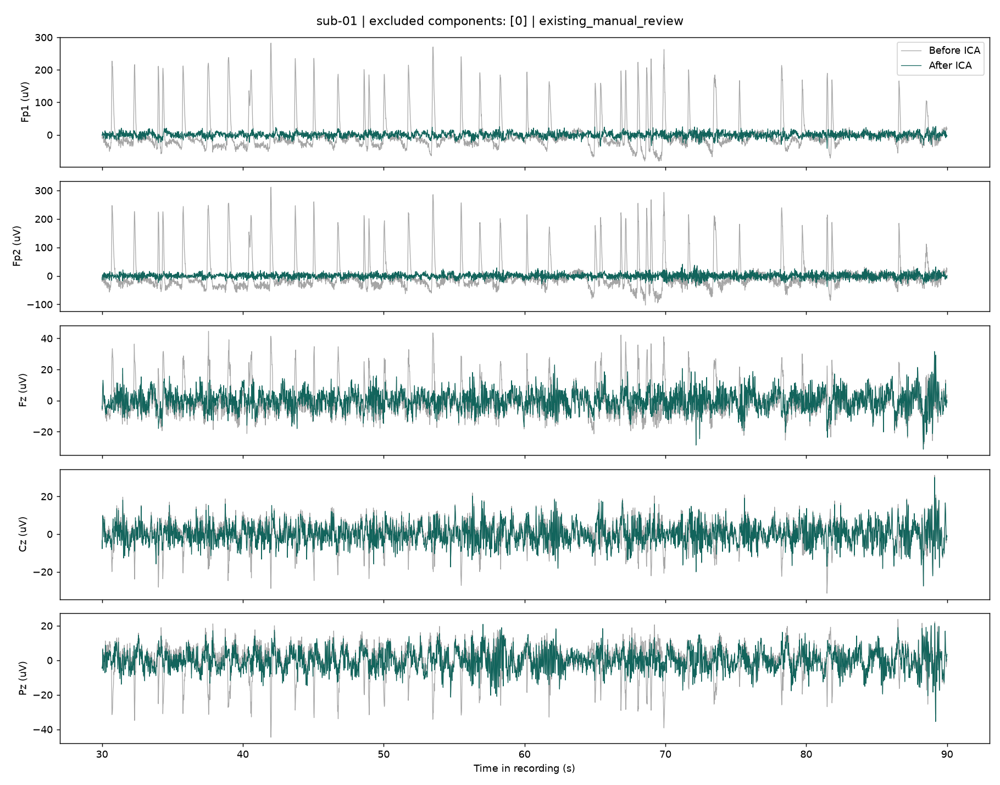

Hình 1. EEG sub-01 trước và sau khi loại thành phần 0 đã được duyệt. Quyết định xuất phát từ việc kiểm tra riêng đường thời gian thành phần ICA. Hình cho thấy tác động lên các kênh trán và đường giữa.

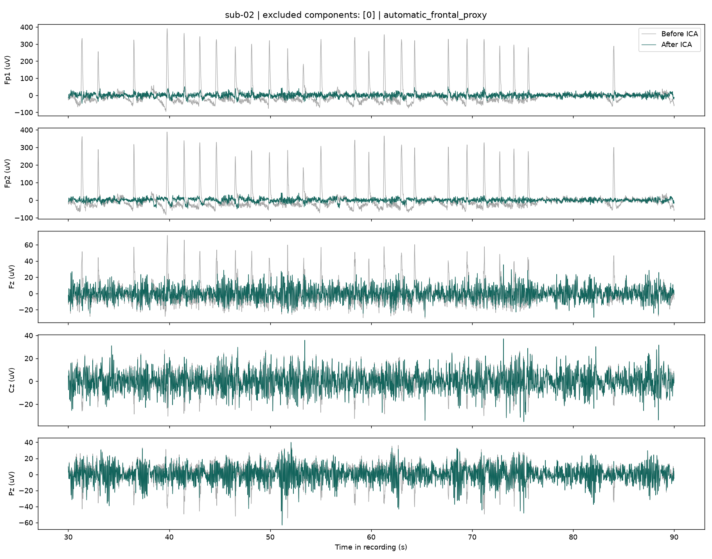

Hình 2. EEG sub-02 trước và sau loại thành phần 0. Các xung lớn vùng trán giảm. Trong đoạn 30–90 giây, biên độ đỉnh-đỉnh Fp1 giảm từ khoảng 486,5 xuống 98,8 µV; Fp2 giảm từ 472,1 xuống 92,0 µV. Cz và Pz có biên độ đỉnh-đỉnh toàn khoảng tương tự trước và sau xử lý. Đây là minh họa kiểm tra tín hiệu cục bộ; hiệu quả phân loại được đánh giá riêng.

### Đầu ra cả nhóm và vấn đề chất lượng còn lại

Lần tạo epoch cuối hoàn tất cho cả 42 người và không ghi nhận lỗi. Mỗi mảng có 16 kênh, 129 điểm thời gian trên mỗi lượt được giữ. Tín hiệu lưu theo volt cùng tên kênh, thời điểm tương đối, mã người, vị trí mẫu kích thích gốc và nhãn 0 standard, 1 target.

| Lớp | Lượt ứng viên | Lượt giữ lại | Lượt bị loại |
|---|---:|---:|---:|
| Standard | 21.018 | 20.827 | 191 |
| Target | 3.422 | 3.399 | 23 |
| Tổng | 24.440 | 24.226 | 214 |

Tỷ lệ giữ chung là 99,12%. Đây là phiên bản xử lý được chọn. ICA loại thành phần ở 29 người, gồm sub-01 đã duyệt thủ công. Có 13 người giữ tín hiệu sau lọc vì chưa có thành phần đạt quy tắc tự động, gồm sub-03, sub-08, sub-12, sub-14, sub-18, sub-23, sub-25, sub-26, sub-30, sub-34, sub-35, sub-40 và sub-41. Tỷ lệ giữ cao chưa đủ để xác nhận EEG hết nhiễu.

| Người tham gia | Standard giữ lại | Target giữ lại | Xử lý ICA |
|---|---:|---:|---|
| sub-01 | 496/498 | 81/81 | Duyệt và loại thành phần 0 |
| sub-02 | 495/498 | 80/81 | Tự động loại thành phần 0 |
| sub-07 | 432/498 | 75/81 | Tự động loại thành phần 0 |
| sub-14 | 479/498 | 78/81 | Chưa có thành phần đạt quy tắc |
| sub-17 | 488/498 | 79/81 | Tự động loại thành phần 0 |

Sub-07 mất nhiều lượt nhất và đáng được ưu tiên kiểm tra tín hiệu. Sub-02, sub-14, sub-17 vẫn được giữ. Các vấn đề hành vi đã biết và việc kiểm tra EEG phản ánh những khía cạnh khác nhau của thí nghiệm. Sub-23 và sub-38 có số sự kiện ban đầu cao hơn đa số người; riêng bảng kiểm kê hiện tại chưa giải thích nguyên nhân.

Các số liệu được đối chiếu với summary sau ICA và kiểm kê chia người do server tạo. Chúng xác định phiên bản tiền xử lý dùng trong các thí nghiệm hiện tại. Khả năng còn nhiễu mắt ở 13 người chưa loại thành phần ICA là một giới hạn.

## Chuẩn bị tập huấn luyện và kiểm tra theo người

Xáo trộn cố định với seed 42 chia 34 người huấn luyện và 8 người kiểm tra. Hai tập không trùng người và bao phủ đủ 42 người. Script chia dữ liệu kiểm tra thứ tự kênh, lưới thời gian và số lượt theo lớp từng người; kết quả được đối chiếu với summary tiền xử lý.

| Tập | Số người | Standard | Target | Tổng lượt |
|---|---:|---:|---:|---:|
| Huấn luyện | 34 | 16.931 | 2.761 | 19.692 |
| Kiểm tra | 8 | 3.896 | 638 | 4.534 |

Tập kiểm tra gồm sub-02, sub-07, sub-08, sub-09, sub-15, sub-16, sub-18 và sub-41. Danh sách chia gốc để trống validation. Khi huấn luyện DL, nhóm lấy bốn người validation bên trong 34 người huấn luyện, như mô tả ở phần sau. Tập kiểm tra dùng cho đánh giá cuối và mô tả độ nhạy khi che tín hiệu. Trạng thái chất lượng xử lý vẫn được lưu trong báo cáo từng người.

## Học máy truyền thống

### Trích đặc trưng và các mô hình ban đầu

Trên mỗi kênh trong 16 kênh, tín hiệu đã chỉnh nền từ 0–1.000 ms được lấy trung bình theo 20 cửa sổ 50 ms liên tiếp, tạo 320 đặc trưng cho mỗi lượt. Thứ tự làm phẳng là theo kênh trước. Cửa sổ cuối chứa điểm 1.000 ms. Mốc thời gian xác định mẫu thuộc cửa sổ nào, vì 50 ms không ứng với số mẫu nguyên ở 128 Hz. Biên độ được đổi sang microvolt.

Nhóm đánh giá baseline luôn đoán lớp đa số, LDA với shrinkage tự động và prior hai lớp bằng nhau, SVM RBF với C=1, gamma=scale và trọng số lớp cân bằng. Bộ chuẩn hóa của LDA/SVM chỉ được fit trên người huấn luyện. Tham số ban đầu được cố định trước đánh giá test. Cả ba dùng 19.692 lượt của 34 người huấn luyện và cùng 4.534 lượt của tám người kiểm tra.

### Kết quả ML trên tập kiểm tra

| Mô hình | Macro-F1 | Standard đúng | Standard đoán target | Target đoán standard | Target đúng |
|---|---:|---:|---:|---:|---:|
| Baseline lớp đa số | 0,4622 | 3.896 | 0 | 638 | 0 |
| Shrinkage LDA | 0,7103 | 3.258 | 638 | 176 | 462 |
| SVM RBF | 0,7578 | 3.690 | 206 | 294 | 344 |

Ma trận nhầm lẫn có hàng là nhãn thật, cột là dự đoán, theo thứ tự standard rồi target. SVM có macro-F1 cao nhất trong các cấu hình ML ban đầu. LDA nhận đúng 462/638 target, tương đương 72,4%; SVM nhận đúng 344, tương đương 53,9%. SVM báo nhầm target ít hơn, 206 so với 638 của LDA. Hai mô hình có sự đánh đổi khác nhau giữa các kiểu lỗi. Baseline bỏ sót toàn bộ target, cho thấy cần thước đo chú ý đến cả hai lớp.

So sánh này áp dụng cho cấu hình và lần chia người hiện tại. Nếu tiếp tục chọn siêu tham số, cần dùng validation theo người trong tập huấn luyện. Thời gian trong JSON bao gồm fit và dự đoán, phụ thuộc môi trường chạy.

## Học sâu

### Biểu diễn đầu vào và kiến trúc

Hai mạng nhận trực tiếp EEG đã chỉnh nền dưới dạng 16 kênh × 129 điểm, bao phủ 0–1.000 ms ở 128 Hz. Mạng học đặc trưng không gian và thời gian từ tín hiệu. Đầu vào DL giữ các mẫu thời gian đã được dùng để tạo đặc trưng trung bình 50 ms cho ML.

Compact EEG CNN của dự án có 1.162 tham số huấn luyện. Lớp tích chập thời gian đầu dùng tám bộ lọc dài 33 mẫu. Tích chập nhóm qua 16 kênh tạo 16 đặc trưng không gian. Sau batch normalization, ELU, average pooling và dropout là tích chập thời gian depthwise dài 17, trộn pointwise, khối pooling thứ hai, global average pooling và lớp tuyến tính hai đầu ra. Xác suất dropout là 0,5. Đây là kiến trúc nhỏ gọn được triển khai riêng trong dự án.

Mạng thứ hai dùng EEGInceptionERP của Braindecode với 16 kênh vào, hai đầu ra, 129 điểm và tần số 128 Hz. Các nhánh thời gian đa tỉ lệ kết hợp xử lý không gian cho phép học bộ lọc ở nhiều độ dài. Mạng được khởi tạo có 15.310 tham số. Thiết kế hướng đến ERP cung cấp một phương án nhỏ gọn khác cho phân loại từng lượt. [9]

### Huấn luyện, validation và chọn checkpoint

Trong 34 người huấn luyện ban đầu, seed 42 chọn sub-10, sub-20, sub-27 và sub-28 làm validation. Ba mươi người còn lại cung cấp 17.383 lượt để fit; validation có 2.309 lượt. Hai mạng dùng cùng danh sách. Tám người test và 4.534 lượt tương ứng giống với phần ML.

Trung bình và độ lệch chuẩn từng kênh được tính trên các lượt và thời gian của nhóm fit. Các giá trị này chuẩn hóa EEG của fit, validation và test. Hàm cross-entropy có trọng số nghịch đảo tần suất lớp, xấp xỉ 0,582 cho standard và 3,566 cho target, tính từ nhãn fit. Nhờ đó target ít gặp có đóng góp lớn hơn trong mục tiêu học.

Bộ tối ưu AdamW có learning rate 0,001 và weight decay 0,01; batch size 64. Hai mạng chạy đủ 100 epoch trên CUDA, tắt dừng sớm. Sau mỗi epoch, tính macro-F1 trên người validation. Checkpoint có macro-F1 validation cao nhất được chọn để đánh giá test. Checkpoint lưu cả chuẩn hóa, thứ tự kênh và phân công người.

| Mạng | Tham số | Epoch đã chạy | Epoch được chọn | Macro-F1 validation tốt nhất | Macro-F1 test |
|---|---:|---:|---:|---:|---:|
| Compact EEG CNN | 1.162 | 100 | 83 | 0,8317 | 0,7937 |
| EEG-Inception | 15.310 | 100 | 80 | 0,8648 | 0,8440 |

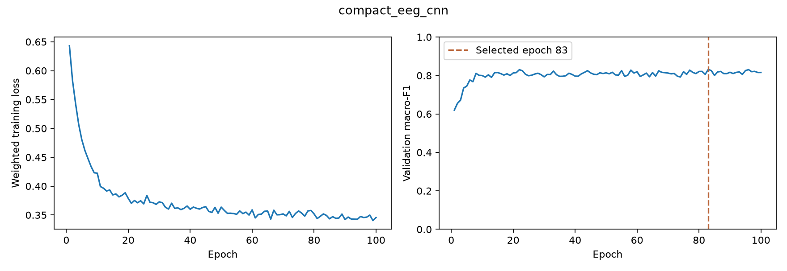

Hình 3. Loss huấn luyện có trọng số và macro-F1 validation của Compact CNN. Đường dọc đánh dấu checkpoint được chọn ở epoch 83.

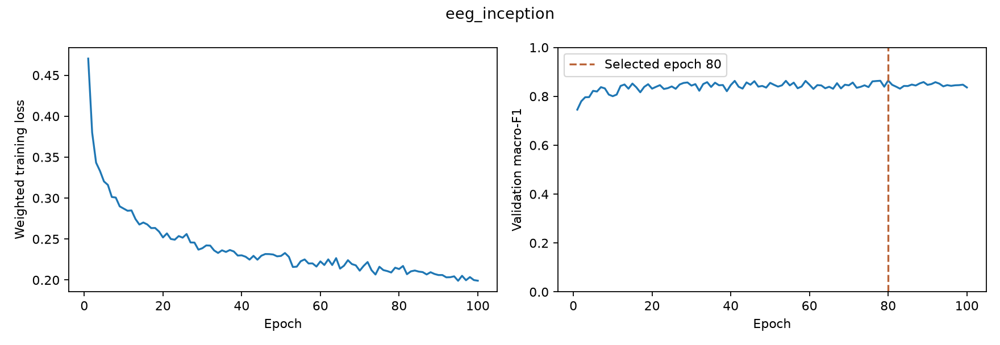

Hình 4. Loss huấn luyện và macro-F1 validation của EEG-Inception. Hiệu quả validation tăng nhanh lúc đầu rồi dao động. Checkpoint tốt nhất ở epoch 80. Macro-F1 validation cuối epoch 100 là 0,8365, thấp hơn mức tốt nhất 0,8648. Đường học hỗ trợ việc chọn checkpoint bằng validation. Nhật ký hiện có loss train và macro-F1 validation, chưa có loss validation hoặc macro-F1 train để so trực tiếp khoảng cách tổng quát hóa trên cùng thước đo.

### Định nghĩa thước đo đánh giá

Macro-F1 là chỉ số chính. Precision và recall được tính riêng cho mỗi lớp, kết hợp thành F1 từng lớp rồi lấy trung bình đều giữa standard và target. Ma trận nhầm lẫn trình bày số lượng dự đoán. Balanced accuracy bổ sung bằng trung bình recall standard và recall target. Hai thước đo cho trọng số ngang nhau ở cấp lớp; macro-F1 còn phụ thuộc precision.

Với mỗi lớp, F1 = 2TP / (2TP + FP + FN). Với hai lớp, balanced accuracy = (recall_standard + recall_target) / 2. Chỉ số được tính trên dự đoán từng lượt gộp từ các người test. Đây là điểm gộp các lượt, khác với trung bình điểm tính riêng từng người.

## So sánh học máy và học sâu

Năm mô hình được đánh giá trên cùng 3.896 standard và 638 target của tám người test. Macro-F1 cho trọng số ngang nhau với F1 của hai lớp, thể hiện rõ việc baseline không nhận được target nào.

| Mô hình | Macro-F1 test | Standard đúng | Standard đoán target | Target đoán standard | Target đúng |
|---|---:|---:|---:|---:|---:|
| Baseline lớp đa số | 0,4622 | 3.896 | 0 | 638 | 0 |
| Shrinkage LDA | 0,7103 | 3.258 | 638 | 176 | 462 |
| SVM RBF | 0,7578 | 3.690 | 206 | 294 | 344 |
| Compact EEG CNN | 0,7937 | 3.620 | 276 | 199 | 439 |
| EEG-Inception | **0,8440** | 3.673 | 223 | 138 | 500 |

Hàng của ma trận là nhãn thật và cột là dự đoán, cùng theo thứ tự standard, target.

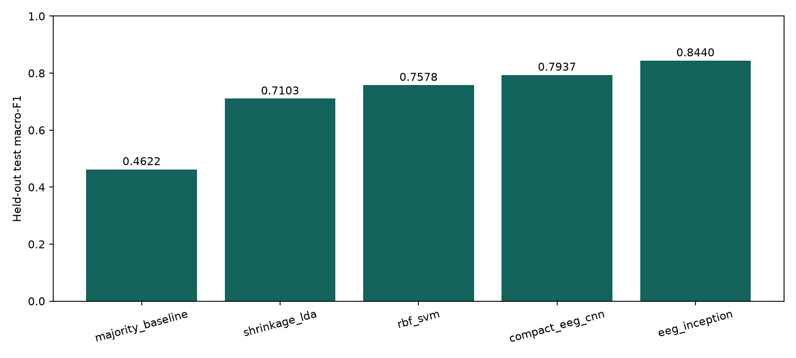

Hình 5. Macro-F1 của năm cấu hình trên cùng nhóm người test.

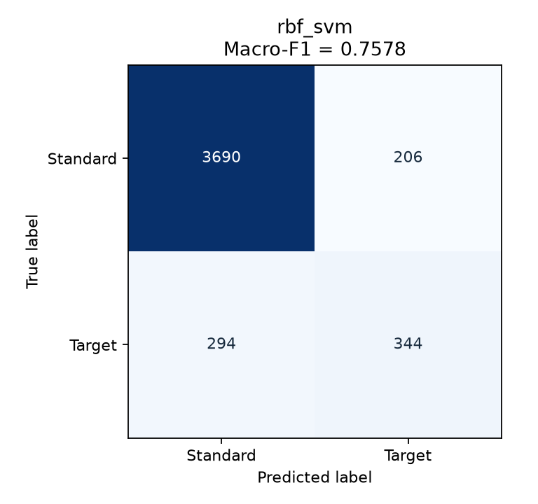

Hình 6. Ma trận nhầm lẫn của cấu hình ML ban đầu có điểm cao nhất.

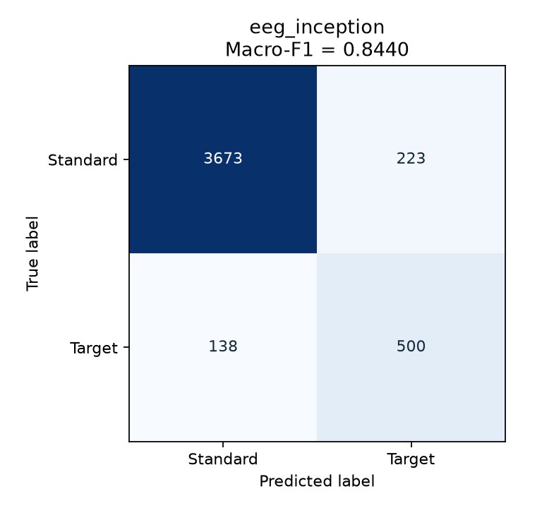

Hình 7. Ma trận nhầm lẫn của cấu hình DL có điểm cao nhất.

EEG-Inception cao hơn SVM 0,0861 macro-F1 và cao hơn Compact CNN 0,0503. Mạng nhận đúng 500/638 target, tương đương 78,4%; Compact CNN đạt 439/638 (68,8%), LDA 462/638 (72,4%), SVM 344/638 (53,9%). So với SVM, EEG-Inception nhận thêm 156 target và thêm 17 lần báo nhầm target. So với LDA, mạng nhận thêm 38 target và giảm 415 lần báo nhầm target.

Balanced accuracy từ cùng ma trận cung cấp góc nhìn bổ sung.

| Mô hình | Macro-F1 | Balanced accuracy |
|---|---:|---:|
| Baseline lớp đa số | 0,4622 | 0,5000 |
| Shrinkage LDA | 0,7103 | 0,7802 |
| SVM RBF | 0,7578 | 0,7432 |
| Compact EEG CNN | 0,7937 | 0,8086 |
| EEG-Inception | 0,8440 | 0,8632 |

EEG-Inception đứng đầu ở cả hai thước đo. LDA có balanced accuracy cao hơn SVM do nhận nhiều target hơn, còn SVM có macro-F1 cao hơn nhờ sự đánh đổi precision–recall khác.

Cùng tập test cho phép so các hệ thống đã fit. Tuy nhiên quy trình fit khác nhau. ML dùng đủ 34 người huấn luyện, DL dùng 30 người fit và bốn người validation. DL chọn epoch từ 100 lần đánh giá validation; ML dùng siêu tham số ban đầu cố định. Cần cân nhắc các khác biệt này khi diễn giải thứ hạng.

## Trực quan hóa và giải thích mô hình

### ERP tại Pz

Với mỗi người trong 34 người huấn luyện, nhóm tính trung bình riêng từng lớp tại Pz, sau đó lấy trung bình các người với trọng số ngang nhau. Vùng tô biểu diễn một độ lệch chuẩn giữa người. Epoch đầu vào bắt đầu ở 0 ms nên đồ thị cũng bắt đầu tại đó.

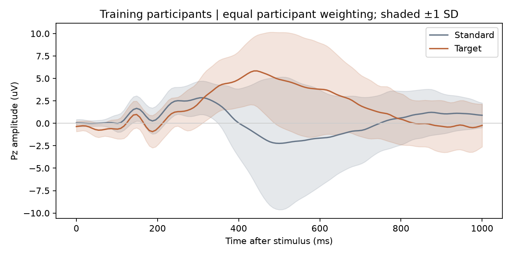

Hình 8. ERP tại Pz của standard và target sau tiền xử lý. Vùng tô mô tả mức biến thiên giữa người.

Target có đáp ứng dương rộng, đạt cực đại trong khoảng 300–600 ms ở xấp xỉ 445 ms với 5,84 µV. Trung bình hai lớp tách nhau trên phần lớn khoảng giữa và muộn sau kích thích. Thời điểm và điện thế dương vùng đỉnh phù hợp đáp ứng P3 Oddball được tác giả dataset thảo luận. Đồ thị có tính mô tả; nhóm chưa kiểm định thống kê chênh lệch dạng sóng. [1]

### Phân bố đặc trưng ML

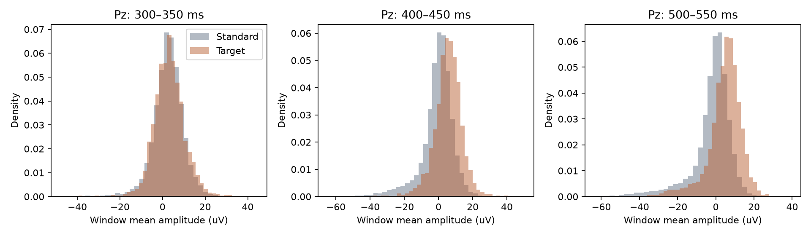

Hình 9. Phân bố đặc trưng trung bình tại Pz trên các lượt huấn luyện ở ba khoảng định trước 300–350, 400–450 và 500–550 ms. Histogram chuẩn hóa riêng từng lớp để số mẫu khác nhau không quyết định độ cao biểu diễn.

Các phân bố minh họa biểu diễn đầu vào của LDA/SVM. Mỗi giá trị tóm tắt một kênh trong cửa sổ 50 ms. Vùng chồng lấp cho thấy riêng một đặc trưng có thể chưa phân biệt rõ nhiều lượt. Mô hình kết hợp thông tin của 16 kênh và 20 cửa sổ. Các hình là ví dụ đặc trưng, chưa đo mức quan trọng của chúng trong mô hình.

### Che theo thời gian trên checkpoint DL

Các checkpoint được đánh giá mà không fit thêm. Trước hết dự đoán nguyên bản được đối chiếu với ma trận nhầm lẫn đã lưu. Sau đó che lần lượt mười khoảng 100 ms liên tiếp, mỗi lần trên cả 16 kênh. Giá trị che bằng 0 sau chuẩn hóa, tương đương trung bình kênh ước lượng trên nhóm fit. Khoảng cuối chứa điểm 1.000 ms.

Mức ảnh hưởng bằng macro-F1 test chưa che trừ macro-F1 sau che. Giá trị dương nghĩa là hiệu quả giảm khi che. Đây là phép thử độ nhạy với can thiệp đầu vào, dùng ý tưởng thay đoạn tín hiệu bằng giá trị tham chiếu trong phương pháp occlusion. Bản triển khai của dự án đánh giá thay đổi hiệu quả tổng hợp theo khoảng. [10]

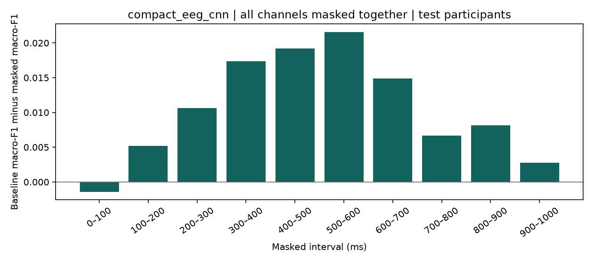

Hình 10. Thay đổi macro-F1 Compact CNN khi che từng khoảng 100 ms.

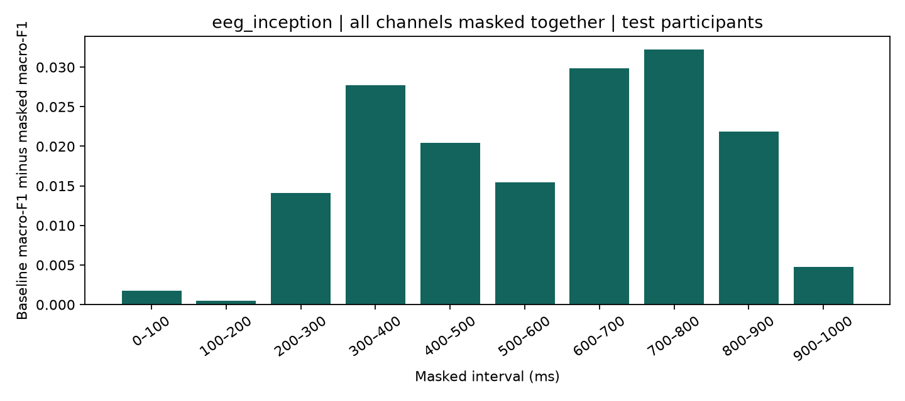

Hình 11. Thay đổi macro-F1 EEG-Inception theo cùng quy trình che.

| Mạng | Khoảng che ảnh hưởng mạnh nhất | Macro-F1 chưa che | Macro-F1 sau che | Mức giảm |
|---|---|---:|---:|---:|
| Compact EEG CNN | 500–600 ms | 0,7937 | 0,7721 | 0,0216 |
| EEG-Inception | 700–800 ms | 0,8440 | 0,8117 | 0,0323 |

Compact CNN còn nhạy ở 400–500 ms, giảm 0,0192, và 300–400 ms, giảm 0,0173. EEG-Inception nhạy với 600–700 ms (0,0299), 300–400 ms (0,0278), 800–900 ms (0,0219), 400–500 ms (0,0204). Khoảng 200 ms đầu tạo thay đổi tương đối nhỏ ở cả hai mạng. Che 0–100 ms làm Compact CNN tăng nhẹ 0,0014 macro-F1; thay đổi hiệu quả có thể mang dấu âm.

Hai mạng nhạy trong khoảng ERP, còn EEG-Inception sử dụng cả thông tin muộn. Việc che 700–800 ms gây giảm mạnh nhất ở EEG-Inception cho thấy quyết định chưa thể quy hoàn toàn cho đỉnh P300. Thông tin muộn có thể liên quan xử lý kéo dài hoặc phản ứng trong tác vụ; các khả năng này chưa được tách bằng thí nghiệm. Kết quả mô tả độ nhạy với cách che đã chọn, chưa xác định nguồn thần kinh mang quan hệ nhân quả.

## Thảo luận các câu hỏi nghiên cứu

### Câu hỏi 1. Kết quả phân loại từng lượt tốt nhất giữa standard và target là gì?

Trong các cấu hình triển khai, macro-F1 test cao nhất là **0,8440**, từ EEG-Inception với 16 kênh và đầu vào từng lượt dài một giây. Ma trận có 3.673 standard nhận đúng, 223 standard bị báo thành target, 138 target bị bỏ sót và 500 target nhận đúng. Kết quả áp dụng cho cách chia theo người cố định và phiên bản tiền xử lý hiện tại, là cấu hình quan sát tốt nhất của dự án.

### Câu hỏi 2. Học sâu có tốt hơn học máy truyền thống khi phân loại từng lượt không?

Hai mạng DL đều vượt baseline ML mạnh nhất về macro-F1. Compact CNN đạt 0,7937 và EEG-Inception 0,8440, so với 0,7578 của SVM. Quan sát hỗ trợ DL trong cấu hình và lần chia đã nghiên cứu. Kết luận rộng hơn cần nhiều lần chia theo người, công sức chọn mô hình tương đương và ước lượng bất định. Đầu vào chuỗi thời gian trực tiếp và đặc trưng trung bình 50 ms giữ mức chi tiết thời gian khác nhau, nên so sánh kết hợp cả lựa chọn kiến trúc lẫn biểu diễn.

### Câu hỏi 3. Có giải thích được đặc trưng do mạng học sâu phát hiện không?

Che theo thời gian giải thích một phần hành vi của mạng đã học. Độ nhạy xấp xỉ 300–600 ms phù hợp điện thế dương target rộng tại Pz. EEG-Inception còn nhạy đáng kể ở 600–900 ms. Phép thử xác định các khoảng đáng xem kỹ và hỗ trợ giải thích dựa trên thông tin giữa và muộn sau kích thích. Do che toàn bộ kênh cùng lúc, phương pháp hiện tại chưa gán ảnh hưởng cho một điện cực cụ thể hoặc phân biệt thành phần ERP, hoạt động vận động và nhiễu còn sót.

## Giới hạn và phạm vi kết luận

- **Một lần chia theo người, một seed huấn luyện.** Chưa có khoảng tin cậy hay kiểm định ý nghĩa theo cặp. Khả năng khái quát ngoài tám người test còn chưa chắc chắn.
- **Quy trình chọn mô hình khác nhau.** ML dùng 34 người fit và tham số cố định. DL dùng 30 người fit, bốn người validation và chọn epoch tốt nhất. So sánh hiện tại bao phủ các quy trình này.
- **Quyết định ICA và nhiễu còn sót.** Mười ba người giữ tín hiệu sau lọc vì không có thành phần đạt quy tắc kênh trán. Ngưỡng 0,9 và ngưỡng gần phẳng 0,1 µV là lựa chọn của dự án. Hai ví dụ trước/sau chưa xác nhận chất lượng sạch nhiễu của mọi người.
- **Lựa chọn kênh và biên độ.** Nhóm chọn 16 kênh và ngưỡng loại trên toàn epoch. Chưa hoàn tất so sánh phân loại đầy đủ 127 với 16 kênh hoặc khảo sát độ nhạy của ngưỡng. Giữ thêm mẫu chưa đủ để xác nhận phân loại tốt hơn.
- **Hành vi và nhãn kích thích.** Nhãn theo loại kích thích ngay cả khi phản ứng sai. Sub-02, sub-14, sub-17 được giữ dù tác giả bộ dữ liệu đã nêu vấn đề hành vi. Điều này có thể tăng biến thiên mức tham gia tác vụ.
- **Phương pháp giải thích còn hạn chế.** Occlusion phụ thuộc giá trị tham chiếu và độ rộng cửa sổ. Che đột ngột có thể tạo đầu vào khác EEG tự nhiên; tác động từng khoảng chưa chắc cộng được với nhau. Ảnh hưởng mạnh ở khoảng muộn có thể chứa nhiều quá trình. Phân tích chưa xác lập nhân quả thần kinh.
- **Việc sử dụng kết quả test.** Nhóm đã xem test để báo cáo và giải thích mô tả. Nếu tiếp tục thay mô hình hoặc tiền xử lý theo những kết quả đó, cần kế hoạch đánh giá mới để hỗ trợ kết luận hiệu quả cuối ít thiên lệch.
- **Hồ sơ tái lập.** Checkpoint lưu chuẩn hóa và phân công người; metric lưu phiên bản thư viện và thiết lập. Mã kiểm tra dữ liệu và báo cáo chất lượng cần đi kèm phiên bản code. Đường dẫn tuyệt đối trong split cần điều chỉnh khi chuyển dữ liệu server.

## Kết luận

Dự án chuẩn bị 24.226 lượt standard/target của 42 người và so sánh ba cấu hình ML với hai mạng DL nhỏ gọn trên tập test không trùng người. EEG-Inception đạt macro-F1 quan sát cao nhất 0,8440. Hiệu chỉnh ICA thử nghiệm giảm các xung vùng trán và giúp giữ thêm lượt. Phép che thời gian cho thấy DL phụ thuộc cả thông tin trong khoảng ERP và thông tin muộn. Kết quả và giải thích áp dụng cho tiền xử lý, cách chia người và quy trình chọn mô hình hiện tại.

## Đóng góp của các thành viên

| Họ và tên | Công việc và đóng góp | Tỷ lệ đóng góp (%) |
|---|---|---|
|  |  |  |
|  |  |  |
|  |  |  |
|  |  |  |

Tổng tỷ lệ đóng góp (%) ____________________

## Tài liệu tham khảo

1. Dzianok P, Antonova I, Wojciechowski J, Dreszer J, Kublik E. The Nencki-Symfonia electroencephalography/event-related potential dataset. *GigaScience*. 2022. [doi:10.1093/gigascience/giac015](https://doi.org/10.1093/gigascience/giac015).
2. Dzianok P, Antonova I, Wojciechowski J, Dreszer J, Kublik E. Nencki–Symfonia EEG/ERP dataset. [OpenNeuro ds004621](https://openneuro.org/datasets/ds004621). [GigaDB dataset DOI](https://doi.org/10.5524/100990).
3. OpenNeuroDatasets. [Oddball acquisition metadata](https://raw.githubusercontent.com/OpenNeuroDatasets/ds004621/main/task-oddball_eeg.json) and [event dictionary](https://raw.githubusercontent.com/OpenNeuroDatasets/ds004621/main/task-oddball_events.json).
4. Project data acquisition inventory. [Oddball EEG dataset and acquisition](data_acquisition.pdf), p. 2.

5. MNE. [Repairing artifacts with ICA](https://mne.tools/stable/auto_tutorials/preprocessing/40_artifact_correction_ica.html).
6. [Electrode subset selection methods for an EEG-based P300 brain-computer interface](https://pmc.ncbi.nlm.nih.gov/articles/PMC4133302/).
7. MNE. [Epochs API and peak-to-peak rejection](https://mne.tools/stable/generated/mne.Epochs.html).
8. Navid MS, Niazi IK, Lelic D, Drewes AM, Haavik H. (2019). The Effects of Filter’s Class, Cutoff Frequencies, and Independent Component Analysis on the Amplitude of Somatosensory Evoked Potentials Recorded from Healthy Volunteers. Sensors 19(11), 2610. [doi:10.3390/s19112610](https://doi.org/10.3390/s19112610).

9. Braindecode. [EEGInceptionERP architecture and ERP reference](https://braindecode.org/stable/generated/braindecode.models.EEGInceptionERP.html).
10. Captum. [Occlusion method and baseline replacement](https://captum.ai/api/occlusion.html). The project uses its own temporal masking implementation.
